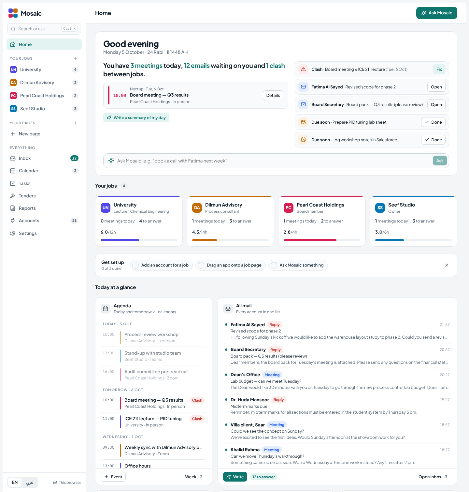

# Mosaic

One command center for someone who works several jobs at once. Calendar, mail, tasks, Salesforce pipeline, tenders and reports sit in one place, coloured by job, with an AI assistant that can see every job at the same time. English and Arabic (right-to-left).



## Install and use

You need [Node.js](https://nodejs.org) 18 or newer and Git.

```bash
git clone <this repository's URL> mosaic
cd mosaic
npm install
npm run build
```

The build makes two pages in `dist/`.

- **`dist/test.html`: try it on your computer.** Open it in a browser. Everything you change is saved in that browser. This mode runs on sample data and has no AI and no live connections, which need claude.ai.
- **`dist/mosaic.html`: the full app on claude.ai.** Publish it as a claude.ai artifact. The easiest way is to ask Claude (Claude Code, or a claude.ai chat that can publish artifacts):

  > Publish `dist/mosaic.html` as an artifact with the capabilities `db`, `user`, `sample`, `downloads`, and `mcp` for Google Drive with the tools `list_recent_files`, `search_files` and `read_file_content`.

  Each person who opens it gets:
  - their own private saved data,
  - AI through their own Claude account,
  - live accounts through their own claude.ai connectors.

  The page stays private to its owner until they share it from its Share menu.

Checks before you change anything:

```bash
npm run check          # type check, unit tests and build
npm run test:browser   # browser walkthroughs (needs: pip install playwright && playwright install chromium)
```

## Licence

No licence has been chosen yet, so all rights are reserved by the author. Please ask before reusing the code outside this project.

## What's in it

**Version 2:**

- **Organised job pages.** Each job opens with a header showing:
  - its role and colour,
  - hours this week against its target,
  - meetings, emails to answer and open tasks,
  - the accounts that belong to the job.

  Below the header, the job's apps and tools sit in a tidy grid of thirds, one or two rows tall.
- **Named accounts per job.** For example "University email" and "Dilmun Advisory email", each tied to its job. Connecting is a three-step flow: choose the app, name it and pick the job, then sign in (demo).
- **Drag-and-drop apps.** Press Customize on any page, then drag LinkedIn, Instagram, an email account, Salesforce, Teams, Zoom, OneDrive or Slack from the panel onto the page. If that job has no account for the app yet, the card offers to connect one there and then.
- **New assistant.** Answers are formatted, and every meeting, draft or task the assistant creates appears as a card with Open, "Review and send" and Undo. It has starter prompts, Copy and Try again (which undoes the previous attempt first).
- **Fast AI for small tasks.** Auto mode sends short questions to the fast model and anything that books, writes or plans to the standard model. You can also pick Fast or Thorough yourself.
- **Getting started.** A three-step checklist on Home.

**Also included:**

- **Home and job pages.** Every page is a grid of widgets you drag and drop, resize and remove: briefing, agenda, clashes, inbox, tasks, pipeline, start a meeting, tenders, time per job, LinkedIn/Instagram, files, notes. You can add your own pages.
- **Calendar.** One week across all calendars (Sunday–Thursday, with Friday and Saturday optional). Meetings from different jobs that overlap get a red outline. You can import an `.ics` file. On a phone it shows one day at a time.
- **Inbox.** Outlook, Gmail and Yahoo in one list.
  - AI sorting and AI-written replies. Nothing is sent without the user.
  - A one-click "wrong job" fix, with a rule per sender.
- **Tasks.** A board with drag and drop. Salesforce tasks and opportunities can be uploaded and downloaded as CSV.
- **Tenders.** Keyword watchlist and deadline countdowns.
  - "What do I need?" checklists.
  - Paste any tender notice and it is read automatically.
- **Reports.** Weekly and monthly reports:
  - hours per job against target,
  - meetings, tasks done and clashes,
  - an AI-written review,
  - export to `.md` or `.csv`.
- **Assistant.** Ask in English or Arabic.
  - It finds free slots across all jobs and books meetings that avoid clashes.
  - It drafts emails, adds tasks and moves meetings. Every action can be undone.
- **Focus mode.** Shows one job everywhere.
- **Command bar.** Opens with Ctrl+K.

## Removing accounts (version 5)

Every account on the Accounts page has a **Remove** button, and so does the edit dialog.

- **Delete its data too.** You can also delete what the account brought into Mosaic: its mail, chats and posts, plus its calendar events, files and Salesforce records once no other account of that kind is left.
- **Remove all demo accounts.** One button clears every sample account at once, so you can start from your real ones.
- **Undo.** Every removal can be undone straight away.
- **Live accounts.** Mosaic keeps no copy of a live account's data. The dialog explains how to stop Mosaic using that claude.ai connector, through the page's permissions.

## Real sending (version 4)

**Send** in the compose window now opens the mail service's own compose page, filled in, in the account the email is from:

- Gmail opens in that Google account.
- Outlook opens Outlook on the web: the work version for a work address, outlook.live.com for a personal one.
- Yahoo opens Yahoo Mail.

You press Send there, so Mosaic never sends anything by itself. A very long message is copied for you to paste in. The Sent list shows which service was used. The full plan for the remaining apps is in `docs/connections-plan.md`.

## Live connections (version 3)

Accounts can now be **live**: Mosaic uses the viewer's own claude.ai connectors (the artifact `mcp` capability), signed in as the person viewing the page. Mosaic never sees a password or token, and claude.ai asks the viewer once before Mosaic may use each connector.

- **Google Drive is live.**
  - The Files card shows your real recent files and searches Drive.
  - It opens files in Drive and writes a short AI summary of any document, sheet, deck or PDF.
  - Optional words narrow a card to one job, e.g. "Dilmun".
- **The assistant can read Drive.** It searches, reads a file, answers, and lists the files it read under the answer. These tools are read-only, and file text is treated as information, never as instructions.
- **Failures are specific.** Each one says what to do and keeps the rest of the page working:
  - not added on claude.ai,
  - sign-in expired,
  - turned off for this page (with a button that opens the page's permissions),
  - connector down: the last files stay on screen, marked "Couldn't refresh".
- **Clear labels.** The connect flow, the Accounts page and every card mark accounts as Live or Demo.
- **Already real before this round:**
  - clash detection, free slots and reports,
  - `.ics` and CSV import and export,
  - the AI features,
  - private saving per user.

### What is still demo, and why

- **Gmail, Google Calendar, Microsoft 365 (Outlook, Teams, OneDrive), Zoom, Salesforce and Slack** have claude.ai connectors, but none of them is connected on the owner's claude.ai account yet.
  - Mosaic only wires a connector after checking its real tool definitions, so these stay demo until they're connected.
  - Then each one is added the same way as Drive: one entry in `LIVE` in `src/lib/live.ts`, plus its card.
- **LinkedIn, Instagram and Yahoo** have no claude.ai connector. Going live there needs Mosaic's own backend with OAuth app registrations. LinkedIn does not allow reading a personal feed, so the LinkedIn card drafts and schedules posts instead.
- Declaring connectors keeps the page private to your organisation. It can't be shared by public link.

## Develop

```bash
npm install
npm test                      # unit tests (logic, importers, undo, live parsing, sending, removing accounts)
npm run build                 # vite build + scripts/assemble.mjs
# dist/mosaic.html  -> the published page (React from cdnjs)
# dist/test.html    -> same page with local React, for browser tests
python3 scripts/shots.py      # screenshots of every screen, desktop and phone, with error checks
python3 scripts/ui_test.py    # walkthrough: drag an app, connect accounts, assistant actions, Arabic
python3 scripts/live_test.py  # live Drive: connect, browse, search, summarise, outages, sign-out, assistant
python3 scripts/send_test.py  # Send opens Gmail / Outlook / Yahoo compose, pre-filled, in the right account
python3 scripts/remove_test.py # remove one account, from the edit dialog, or all demo accounts, with Undo
```

## AI models

Inside claude.ai the page uses Claude through the viewer's own account, choosing between a fast model and a stronger one per task. Other model providers can't be called from the page itself, because it has no server and API keys can't live in a web page.

Adding them later means a small backend with a model router. For example:

- Meta's Muse Spark through the Meta Model API or OpenRouter.
- A small open-weight model (such as Meta's Muse Glimmer) self-hosted for quick tasks.

## Code map

- `src/types.ts`: the data model.
- `src/store.tsx`: state, saving and undo.
- `src/lib/logic.ts`: clashes, free slots and reports.
- `src/lib/importers.ts`: `.ics` and CSV.
- `src/ai/assistant.ts`: the assistant's instructions and the actions it can take.
- `src/widgets/tools.tsx`, `src/widgets/apps.tsx`: the cards.
- `src/PageView.tsx`: page headers, grid and Customize mode.
- `src/views/ConnectWizard.tsx`: adding and editing accounts, including the live connect flow.
- `src/lib/live.ts`: live connections. Which connectors are wired (`LIVE`), the copy for each failure, Drive parsing and the `useLiveWatch` hook.
- `src/widgets/drive.tsx`: the live Google Drive card.
- `src/ai/liveTools.ts`: the assistant's read-only Drive tools.
- `src/Assistant.tsx` and `src/lib/markdown.tsx`: the assistant.
- `src/views/*` and `src/App.tsx`: the other screens and the shell.
